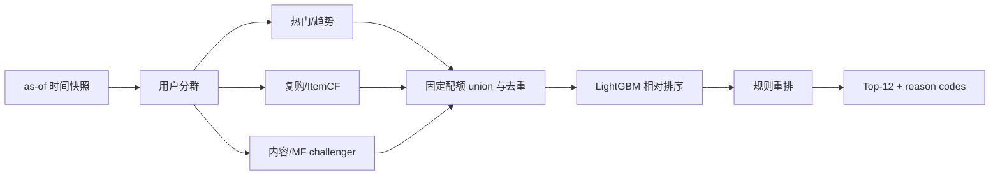

# H&M V1 推荐架构冻结

状态：`FROZEN_FOR_STAGE_2_IMPLEMENTATION`

冻结范围：业务任务、用户分群、召回、候选协议、粗排边界、精排与重排路线。

不代表：任何模型已经实现、训练或取得离线收益。

## 1. 证据边界

本架构只使用 Stage 1A/1B 正式聚合产物：

- 105,542 个 articles、1,371,980 个 customers、31,788,324 条 transactions；
- articles/customer 候选主键均无重复，交易到两张主表的全量外键匹配率均为 100%；
- 2,974,905 条全字段重复超额记录；缺少 order_id、quantity 和精确时间，不能解释为脏数据或真实件数；
- B 口径有 28,575,395 个 user-item-day 交互，47.30% 用户至少有 10 条，30.13% 至少有 20 条；
- 商品 Gini 为 0.7586，Top 10% 商品贡献 60.75% 原始记录；
- 49.21% 用户存在相同 article 重复记录；
- 14 天窗口有 117,366 个可评用户，用户可见率 91.45%，warm user-item 行覆盖上限 83.95%；
- 全量分析峰值 RSS 约 1.23 GiB、临时盘约 5.72 GiB，V1 离线实现必须继续采用分阶段、可恢复计算。

证据入口为：

- `artifacts/stage_1a/audit_summary.json`
- `artifacts/stage_1a/audit_results.csv`
- `artifacts/stage_1b/profile_summary.json`
- `artifacts/stage_1b/model_evidence_matrix.csv`
- `artifacts/stage_1b/time_split_comparison.csv`
- `artifacts/stage_1b/resource_usage.json`

## 2. 冻结的业务任务

| 项目 | V1 决策 |
| --- | --- |
| 推荐场景 | 面向已知 customer 的离线日批个性化商品推荐，可服务首页或消息触达原型；不假设真实线上曝光链路 |
| 请求时点 | 每个标签窗口开始日 00:00 的逻辑快照 |
| 推荐对象 | `article_id`；仅能依据 articles 主表定义候选，因缺少库存而不能保证可售 |
| 预测窗口 | 主窗口未来 14 个自然日；7 天快速开发，28 天稳健性检查 |
| 输出 | 每用户 Top-12 去重 article 列表及可解释召回原因 |
| 主正样本 | B 口径：窗口内至少一次 user-item-day 购买 |
| 可评用户 | 请求时点前见过且标签窗口至少有一个 B 口径正样本的用户 |
| 冷用户 | 请求时点前 B 口径历史长度为 0 |
| 任务性质 | 隐式购买反馈 Top-K 相对排序 |
| 明确排除 | 无偏 CTR/CVR、概率校准、因果推荐、库存感知、真实购物篮顺序、真实 quantity 预测 |

## 3. 用户分群

`history_len_B` 只统计请求时点之前的 B 口径交互。

| 分群 | V1 阈值 | 可用召回 | 不适用或受限 | fallback | 分群评估 |
| --- | ---: | --- | --- | --- | --- |
| cold | 0 | 全局热门、时间趋势、内容/属性、冷商品探索 | 个性化 ItemCF/MF/序列不适用 | 趋势 + 内容 + 热门补齐 | Recall/HitRate@12、冷用户覆盖 |
| short-history | 1–4 | 热门、趋势、内容、复购；ItemCF 低权重 | MF 不稳定；序列模型不进入 V1 | 内容/趋势补齐 | 分群 Recall@K、来源贡献 |
| warm | 5–20 | 热门、趋势、复购、ItemCF、内容、MF challenger | 序列模型仅对其中 10+ 子群实验 | 多路 union | Recall/MAP/NDCG、候选覆盖 |
| active | 21+ | 全部 V1 路径；序列/双塔仅增强实验 | 不默认启用深度模型 | V1 多路 union | 准确率、长尾、多样性、延迟 |

阈值来自 Stage 1B 的 5/10/20 覆盖断点和 21+ 分桶：21+ 用户占 28.98%，贡献 77.97% 二值交互。它们是 V1 工程规则，不是行业标准。

## 4. V1 多路召回

| 来源 | 决策与角色 | 用户群 | 初始配额 | 主要证据 | 时间泄漏控制 |
| --- | --- | --- | ---: | --- | --- |
| `global_popularity` | 进入；baseline/fallback | 全部 | 100 | Gini 0.7586；Top 10% 贡献 60.75% | 只统计请求时点前记录 |
| `time_trend` | 进入；短期趋势主召回 | 全部 | 100 | 月度峰谷和渠道结构随时间变化 | 窗口止于请求时点前一天 |
| `repurchase` | 进入；个性化主召回 | 有历史用户 | 50 | 49.21% 用户有同 article 重复记录 | 只使用历史购买；保留跨日/同日语义 |
| `itemcf` | 进入；个性化主召回 | short/warm/active | 300 | 28.58M 二值交互，47.30% 用户有 10+ 行为 | 共现矩阵只由训练期构建 |
| `content` | 进入；主召回与 cold-item 路径 | 全部，尤其 cold/short | 200 | 25 个 article 字段；995 个零交易 article | 只用静态商品属性和训练期可见状态 |
| `matrix_factorization` | P0 challenger；通过门禁后加入 V1 | warm/active | 300 | 1.36M 交易用户、104.5K 交易商品 | 因子只用训练期 B 口径拟合 |
| `cold_fallback` | 进入；策略层补齐 | cold/候选不足用户 | 补至 500 | 14 天冷用户 8.55%、冷商品 6.98% | 冷商品仅依据请求时点可知属性 |
| `two_tower` | 不进 V1 主线；P2 | warm/active | 0 | 数据量可支持实验，但无负反馈和收益证据 | Stage 2 V1 不实现 |
| `sequence_model` | 不进 V1 主线；P2 活跃子群 | 10+，优先 21+ | 0 | 10+ 覆盖 47.30%，20+ 覆盖 30.13% | Stage 2 V1 不实现 |

配额是首轮工程配置，必须通过 validation 调整，不能表述为效果结论。双塔和序列模型不能替代 V1 基线，因为当前没有离线增益、延迟或维护成本证据。

## 5. 候选协议与融合

每条召回输出统一为：

| 字段 | 含义 |
| --- | --- |
| `request_id` | 逻辑请求或评估快照标识 |
| `customer_key` | 内部受控用户键；不得进入公开产物 |
| `article_key` | 内部受控商品键；不得进入公开产物 |
| `source` | 召回来源 |
| `raw_score` | 来源原始分数 |
| `normalized_score` | 来源内单调归一化分数，不跨实验偷看 test |
| `source_rank` | 来源内名次 |
| `reason_code` | `POPULAR`、`TREND`、`REPURCHASE`、`ITEMCF`、`CONTENT`、`MF`、`COLD_FILL` |
| `as_of_date` | 所有统计可见截止日 |
| `source_version` | 数据、参数和代码版本 |

融合冻结为“固定配额 union + article 去重”：

1. 各来源按 `source_rank` 截取配额；
2. 以 `(request_id, article_key)` 去重；
3. 保留 `source_count`、所有 `reason_code`、各来源原始/归一化分数和最佳来源名次；
4. 不全局过滤已购商品，因为复购证据强；使用 `previously_purchased` 标记交给排序/重排控制；
5. 内容召回为零交易或训练期冷商品预留最多 50 个探索位；
6. 候选不足时由趋势、内容、热门依次补齐至 500；
7. 启用 MF 时原始配额和可能超过 1,000，融合后总候选硬上限为 1,000。

选择固定配额 union，是因为它可解释、可复现并能直接度量各路独立贡献和 union 增益。Round-robin 作为 P1 对照；简单加权需要先解决跨来源分数标定；训练式融合留待已有可靠候选日志和排序样本之后。

## 6. 粗排决策

V1 不设置独立学习式粗排。

- 融合后最多 1,000 个候选，V1 可由 LightGBM 直接评分；
- 规则层只做合法性、配额、去重和硬约束，不伪装成粗排模型；
- 触发独立粗排的条件：候选上限超过 3,000，或排序特征获取/评分的 P95 资源预算不达标；
- 触发后优先使用可解释规则或轻量 LightGBM，不为了链路形式完整而增加 LR。

粗排只负责低成本缩量；精排负责个性化相对排序，重排负责列表约束。

## 7. 精排路线

V1 强基线冻结为 LightGBM ranking：

- 训练样本必须通过“按历史时点重放召回”生成，分布与线上候选一致；
- B 口径窗口内购买为正样本；
- 候选中未购买条目只能称为“未观察到购买的采样候选”，不能称为真实不喜欢；
- 目标是组内相对排序，不输出校准 CTR/CVR 概率；
- 特征边界包括来源/名次/分数、用户历史聚合、商品热度与属性、用户—商品历史关系、时间间隔；所有特征必须 as-of cutoff。

路线顺序：

1. 规则/来源分数基线；
2. LightGBM ranking 强基线；
3. LR/GBDT 作为简单可解释对照；
4. DeepFM 为 P1 对照；
5. Wide&Deep、双塔分数特征、DIN/序列增强为 P2。

DeepFM、Wide&Deep 或 DIN 不进入 V1 主线，因为当前数据没有曝光/真实负反馈，且 Stage 1B 不能证明其收益。

## 8. 重排路线

V1 采用确定性约束重排，不训练多目标模型：

- 同一 `article_id` 只保留一次；
- Top-12 内同一 `product_code` 初始最多 2 个；
- 同一 `garment_group` 初始最多 4 个；
- 已购商品允许保留，但除明确复购候选外限制连续重复；
- 监控平均流行度、Top 10% 热门占比、catalog/long-tail coverage；
- 内容召回的冷商品可获得最多 1 个探索位，但不能突破基本相关性门槛；
- 颜色、department、garment group 多样性作为辅助目标。

排序主指标不得因多样性优化显著下降。所有阈值是 validation 上的 V1 起点，P1 进行敏感性实验。

## 9. 离线链路

每层都必须保存配置、数据 fingerprint、as-of 日期和来源贡献的聚合指标，但不得公开真实用户或商品明细。

## 10. Stage 2 实现边界

Stage 2 可以按 P0 顺序实现数据切分、可重放候选和基线实验，但必须再次获得明确授权。本文件没有实现召回、特征、训练、排序或服务代码。
